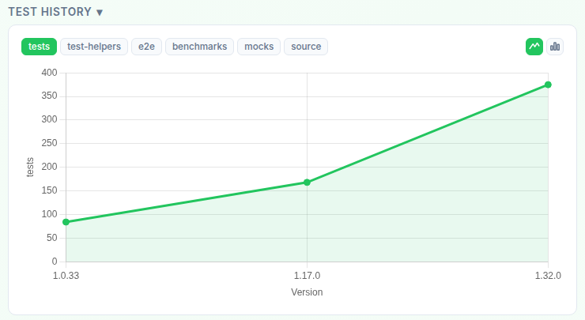
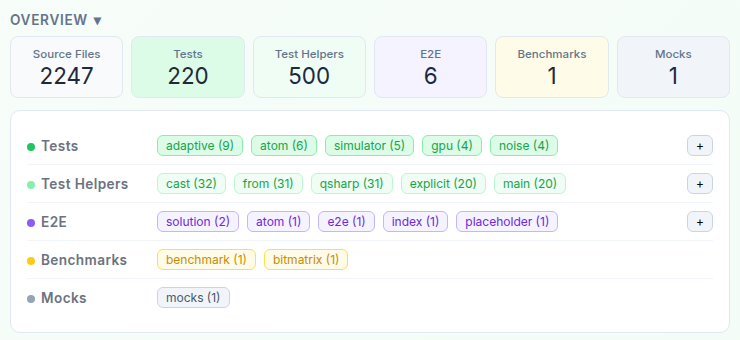
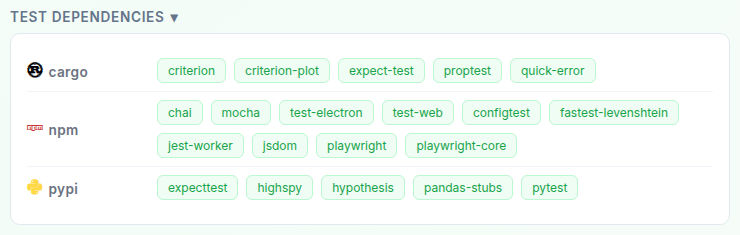
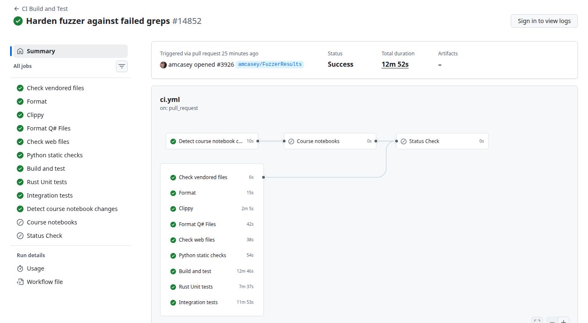
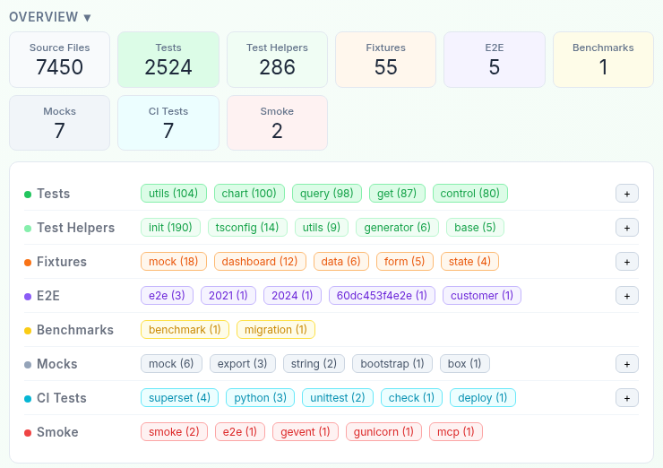
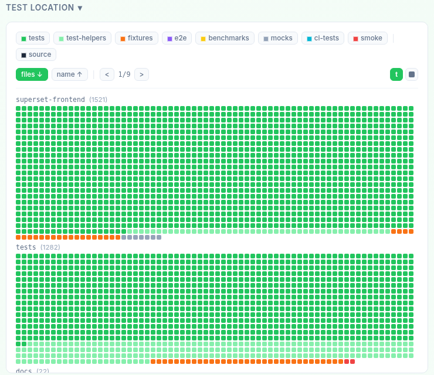
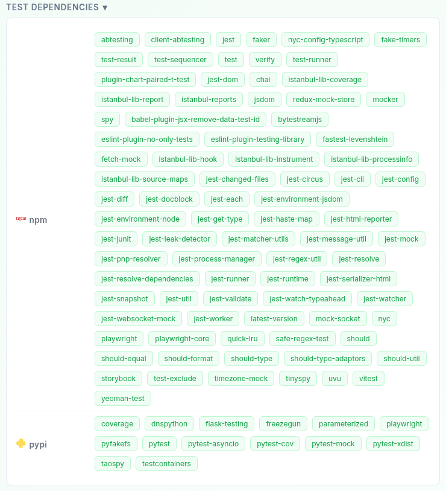
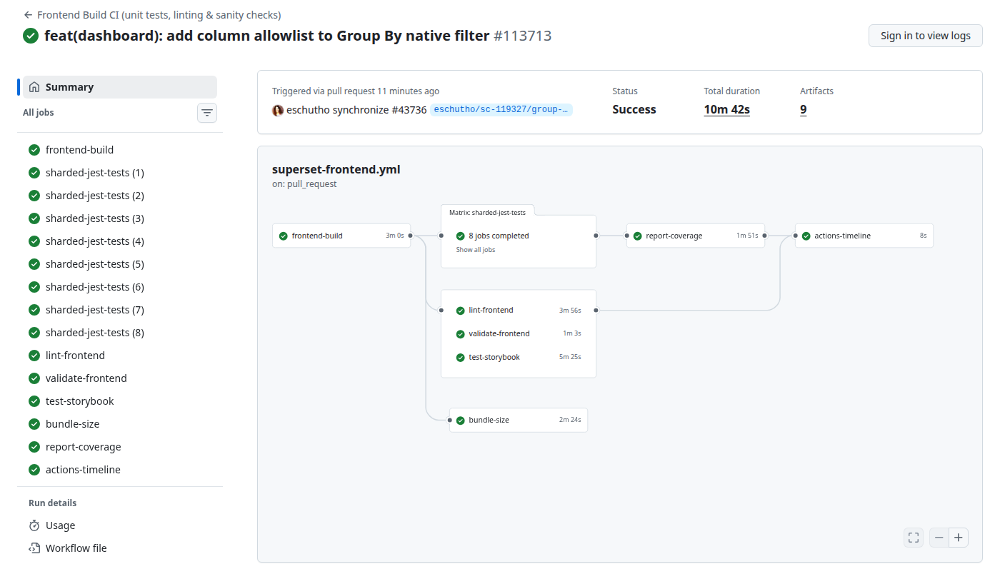

# Explorando Práticas de Teste

Neste exercício, vamos explorar práticas de teste em sistemas reais utilizando a ferramenta [TestMiner](https://andrehora.github.io/testminer).

O TestMiner permite visualizar e analisar testes de software em repositórios do GitHub, fornecendo dados sobre como os projetos organizam seus testes, como eles evoluem entre versões e quais bibliotecas de teste são utilizadas.
Explore a ferramenta antes de começar para se familiarizar com seu funcionamento.

Mais detalhes no GitHub da ferramenta: https://github.com/andrehora/testminer.

---

## Passo 1: Selecionar DOIS repositórios

Escolha dois repositórios reais que possuam testes de software.
Abaixo estão alguns links para ajudá-lo a encontrar projetos interessantes:

- Python: https://github.com/topics/python?l=python
- JavaScript: https://github.com/topics/javascript?l=javascript
- TypeScript: https://github.com/topics/typescript?l=typescript
- Java: https://github.com/topics/java?l=java

- Tópicos: [ai](https://andrehora.github.io/testminer/#topic:ai), [llm](https://andrehora.github.io/testminer/#topic:llm), [api](https://andrehora.github.io/testminer/#topic:api), [nodejs](https://andrehora.github.io/testminer/#topic:nodejs), [android](https://andrehora.github.io/testminer/#topic:android)

- Por organização: [Google](https://andrehora.github.io/testminer/#google), [Microsoft](https://andrehora.github.io/testminer/#microsoft), [Apple](https://andrehora.github.io/testminer/#apple), [Facebook](https://andrehora.github.io/testminer/#facebook), [Netflix](https://andrehora.github.io/testminer/#netflix), 
[GitHub](https://andrehora.github.io/testminer/#github), [Apache](https://andrehora.github.io/testminer/#apache), [HuggingFace](https://andrehora.github.io/testminer/#huggingface)

## Passo 2: Explorar os repositórios selecionados

Busque os repositórios escolhidos no [TestMiner](https://andrehora.github.io/testminer) e analise os dados de teste gerados pela ferramenta.

## Passo 3: Explicar as prática de teste

Para cada repositório, escolha uma prática ou dado de teste relevante e explique com suas próprias palavras.

---

## Instruções de entrega

1. Faça um `fork` deste repositório (saiba mais sobre forks [aqui](https://docs.github.com/pt/pull-requests/collaborating-with-pull-requests/working-with-forks/fork-a-repo)).
2. Responda às questões abaixo diretamente neste arquivo `README.md` do seu fork. Pode adicionar imagens para enriquecer sua explicação.
3. No Moodle, submeta apenas a URL do seu fork.

---

## Respostas

### Repositório 1 

Repositório: https://github.com/microsoft/qdk

URL TestMiner: https://andrehora.github.io/testminer/#microsoft/qdk

Explicação:

O QDK é o kit de desenvolvimento quântico da Microsoft (linguagem Q#, simulador, estimador de recursos e os Quantum Katas e nunca tinha ouvido falar dessa linguagem). Olhando os testes, me chamou atenção a evolução dos testes entre as versões. No gráfico de Test History, a versão 1.0.33 tinha cerca de 80 arquivos de teste, a 1.17.0 passou para uns 170 e a 1.32.0 já tem quase 370. Ou seja, o número de testes mais que quadruplicou enquanto o projeto crescia, o que mostra que os desenvolvedores foram escrevendo testes junto com as novas funcionalidades.

Outro ponto interessante é que, na branch `main`, aparecem mais arquivos de **Test Helpers (500)** do que de **Tests (220)**. Faz sentido para um compilador pois boa parte do código de teste são programas Q# de exemplo e utilitários usados como entrada para vários testes ao mesmo tempo.

Isso também explica as dependências de teste de três ecossistemas diferentes (cargo, npm e pypi) porque o núcleo em Rust é testado com `proptest`, `expect-test` e `criterion` (benchmarks), a extensão do VS Code com `mocha` e `playwright`, e o pacote Python com `pytest` e `hypothesis`. Cada parte do projeto usa as ferramentas da sua linguagem.

Fui olhar o GitHub Actions do projeto para ver como esses testes são executados na prática. O workflow principal, `CI Build and Test` (`ci.yml`), roda em todo pull request e é dividido em vários jobs em paralelo.

Primeiro vêm as verificações de estilo: `cargo fmt`, `clippy` , formatação dos arquivos Q#, checagem do código web e checagem estática do Python. Depois vêm os testes de verdade: *Build and test*, *Rust Unit tests* e *Integration tests*. 

No run que capturei, todos passaram em cerca de 13 minutos. Além disso, existem workflows separados para rodar o build e os testes em Linux, Windows e macOS (`multiplat.yml`), para **fuzzing** do compilador (`fuzz.yml`, que gera entradas aleatórias para tentar quebrar o parser) e para relatórios de benchmark. 

### Repositório 2

Repositório: https://github.com/apache/superset

URL TestMiner: https://andrehora.github.io/testminer/#apache/superset

Explicação:

O Superset é uma plataforma de visualização de dados com backend em Python (Flask) e frontend em React/TypeScript. Eu escolhi a separação dos testes entre frontend e backend, cada um com seu próprio conjunto de ferramentas.

Na Test Location, os testes estão concentrados em duas pastas: `superset-frontend` (1521 arquivos) e `tests` (1282 arquivos), que é onde ficam os testes do backend. No total, o TestMiner encontrou 2524 arquivos de teste para 7450 arquivos de código.

As dependências mostram bem essa divisão. No npm aparecem `jest`, `jest-dom`, `eslint-plugin-testing-library` e `playwright` para testar a interface. No pypi aparecem `pytest`, `pytest-cov`, `pytest-xdist` e `flask-testing` para a API.

Também dá para ver o uso forte de **mocks** com `redux-mock-store`, `fetch-mock`, `mock-socket` e `timezone-mock` no frontend; `pytest-mock`, `freezegun` (que "congela" a data e a hora) e `pyfakefs` (sistema de arquivos falso) no backend. Além disso, o projeto tem 55 arquivos de fixtures e até testes de CI e de smoke. Na minha percepção , isso mostra um projeto grande que precisa isolar cada parte (banco, rede, horário, arquivos) para que os testes sejam rápidos e não quebrem por motivos externos.

No Actions a mesma separação aparece. Há um workflow só para o frontend, o `Frontend Build CI (unit tests, linting & sanity checks)`, e outro só para os testes Python, o `Python-Unit`, além de workflows para testes de integração, E2E, Helm e outros. 

Como são muitos testes Jest, eles são divididos em **8 shards** (`sharded-jest-tests (1)` a `(8)`), que rodam em paralelo. No final, um job `report-coverage` junta a cobertura de todos e envia para o Codecov. Do lado do Python acontece algo parecido: o `pytest` roda com `-n auto` (vários processos em paralelo via `pytest-xdist`), e algumas partes, como `superset/sql/` e `superset/semantic_layers/`, são obrigadas a ter **100% de cobertura** (`--cov-fail-under=100`), senão o CI falha. Outro detalhe é que os workflows verificam quais arquivos mudaram, se um PR não mexe no frontend, os testes do frontend são pulados, o que economiza tempo com uma suíte desse tamanho e tempo de teste.

